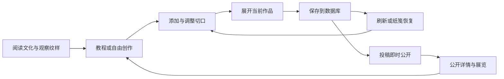

# 纸上生花设计说明

## 参赛主题与方向

|项目|选择|
|---|---|
|参赛主题|主题二：匠心传承，非遗焕新|
|参赛方向|创意网站|
|网站定位|以剪纸为核心的非遗文化专题门户，融合技艺互动体验与作品展览|

本项目选择主题为“匠心传承，非遗焕新”。参赛方向为创意网站。

本项目通过文化札记、纹样观察和渐进教程组织信息，以剪纸工作台承接动手体验，再由作品展览形成内容回流。公开内容提供独立地址与服务端正文，搜索分类帮助获取信息，数据库和后台支撑持续维护，响应式布局覆盖不同屏幕宽度。

## 作品定位

《纸上生花》面向想了解剪纸、但缺少制作经验的访客。网站让访客先辨认纸面与留白，再用可控制的简单切口制作自己的窗花，最后保存并放进展览。文化内容引导体验，创作结果回到展览，形成可以继续阅读和练习的路径。

数字作品采用项目原创几何练习，文化札记标注可靠来源。纸面、切口与留白将传统剪纸的观察方式转化为可操作的数字体验。

## 用户与任务

|使用者|主要任务|设计回应|
|---|---|---|
|第一次接触剪纸的访客|看懂一个切口如何变成完整图案|观察台并列纸角和整图，教程逐步提示添加、展开及保存|
|手机创作者|不用精确拖动也能完成作品|按钮添加、选择切口、方向移动、尺寸与角度调整|
|继续练习的访客|找到上次作品与练习进度|我的纸笺按草稿、学习足迹和收藏组织；练习关联具体草稿|
|观众|欣赏、搜索、查看作品并尝试再创作|公开展览、作品独立详情、分类搜索及再创作入口|
|内容维护者|更新文化正文和整理展品|受保护后台，内容发布状态与展品排序影响前台|

## 信息架构

|页面|内容与主要出口|
|---|---|
|首页 `/`|双燕与留白、四扇纸窗、三景长卷、折展示例；通往四个主要栏目|
|学堂 `/learn`、`/learn/[slug]`|原创纹样观察台、札记列表、分类、搜索、正文目录、来源和关联纹样|
|教程 `/tutorials`、`/tutorials/[slug]`|可操作折展示意、课程步骤与进入工坊的练习签|
|工坊 `/studio`|落刀、对称预览、撤销重做、展开、命名、保存、导出和投稿|
|展览 `/gallery`、`/gallery/[id]`|圆形装裱封面、作品陈列、筛选、详情、收藏和再创作|
|纸笺 `/me`|当前浏览器的草稿、投稿、学习进度及收藏|
|来源 `/about`|设计手记与文化材料来源|
|管理 `/admin`|登录、内容编辑、发布状态、作品排序及撤展|

搜索与分类进入网址参数，详情返回保留当前会话最近的筛选入口。页内步骤定位结合滚动和焦点，保存后保持锚点。空状态提供下一步操作，接口错误提供重试，不能只留下空白区域。

## 视觉语言

主色以朱砂红、纸白和墨黑为基础。朱红表达实际纸面、主按钮与作品，纸白承担留白和阅读，墨色提供文字层级。标题使用系统宋体类字体，正文使用系统中文无衬线字体；不分发字体文件。

背景纸纹、网格、纸边、木框与装裱采用原创CSS和SVG。首页与栏目保持同一套展签、细线和留白规则，同时通过场景分工区分内容：学堂为深色纹样图谱，教程突出折展台，工坊以浅色裁切垫承载操作，展览以朱红展墙承载作品。

布局以阅读与操作的顺序为基础。手机上图谱、说明与工具改为纵向组织；工坊采用点按和按钮调整。界面规格覆盖720、1440和1920宽度，另对小屏做适配。

## 剪纸交互

编辑只开放圆形、三角形、水滴三类参数化切口及一种对称模式。先放置一个切口，再改变位置、大小、长宽比或角度，比一开始暴露任意绘图工具更容易理解。完整作品的留白与当前切口数据同步。

展开不是独立播放的成品视频：当前模型依次呈现1、2、4、8个扇区，纸色与每个镂空仍来自用户实际作品。用户可跳过展开过程，减少动态效果时直接显示完整作品。SVG与PNG导出都取自同一模型。

教程强调动作与结果：添加、展开、保存后才出现对应的记录步骤入口。服务器校验本次练习归属和进度顺序；“动作是否完成”的具体判断还依赖前端提示，不能当作防作弊测评。重新练习从本次零步开始，历史最高进度保留。

## 动效分工

|动效|表达与实现范围|
|---|---|
|推窗与分章进入|工坊回纹双扇内开；学堂翻图谱、教程折纸、展览圆形揭幕，目标页就绪后接住画面|
|三景长卷|当前一景的月光移动，云线、前景线与水纹单向流动；双副本错相淡出，在透明时重置|
|顶部光影|学堂、教程、展览使用窗影与柔光移动；学堂装饰纹样微转；展览外圈与底座光泽流转，作品本身固定|
|视口揭示|首页后续内容按行和实际布局顺序渐显；首屏主要操作和互动区不等待这段揭示|
|飘纸|上缘偏右随机纸屑，单片3–5秒；保留并发上限，后台标签暂停|
|操作反馈|新增切口纸屑、保存状态、失败重试与焦点落点，反馈应对应真实操作结果|

三景循环6–9秒，章节窗影8秒往返，学堂纹样12秒往返，展览外圈24秒一周。持续动效以transform、opacity为主，内部小组承担环境循环，外层承担切景过渡，避免争用同一变换。组件完全离开视口、标签页隐藏时暂停；减少动态效果时保留完整静态内容。现有大留白和色彩风格不因动效更改。

## 可访问性与限制

使用语义标题、导航和cookie，按钮保留可见焦点，图像提供文字标签，错误与状态提供提示。手机不依赖悬停完成核心任务，键盘可操作主要入口。减少动态效果已做专项检查；全站读屏与全部辅助技术没有完成认证式验证。

当前没有跨设备账户找回、任意曲线切割、识图导入、真实纸张连通性或强度检查。数字作品不能直接保证可手工剪成完整实体。完整的限制和测试边界见[测试与适配说明](测试与限制.md)。
